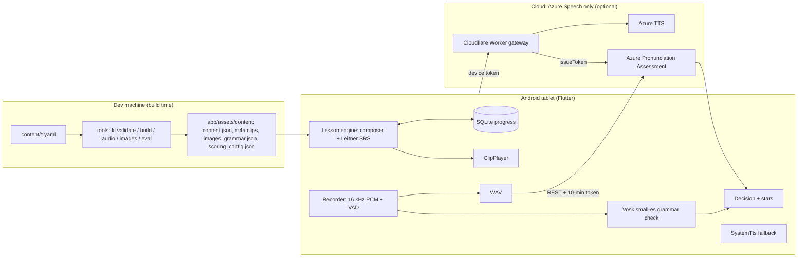

# Implementation plan: Spanish learning app for kids

Date: 2026-11-08 · Status: proposed. Based on the [research notes](research/2026-11-08-original-research-notes.md) and four [verification reports](research/).

Each part of the build is specified in its own issue. The specs live in [`docs/issues/`](issues/) and are mirrored as GitHub issues #1–#25; this document is the overview.

## 1. Goal and constraints
- **Who:** our own kids, aged 6–10, beginners, in an English-speaking home.
- **Device:** **Android tablet first** (owner decision, 2026-11-08); iPad later.
- **Voice:** voice output (model pronunciation) and voice input (the child speaks and gets feedback).
- **Money:** no subscription; running costs near zero; one-off costs kept small.
- **Licensing:** personal, non-commercial. Licensing and COPPA publishing duties only matter if we ever publish. **Provider terms of service apply either way.**

## 2. Key decisions
| # | Decision | Why | Issue |
|---|---|---|---|
| D1 | Flutter, Android first, iPad-ready | One codebase; the iPad port later needs only a speech bridge and a build setup | #2 |
| D2 | All fixed lesson audio is pre-generated, approved and bundled | Best quality, offline, near-zero cost; only free-form speech needs live TTS | #7 |
| D3 | Lesson voice: **Azure Neural/HD TTS** by default; ElevenLabs only if the terms review allows | Azure is terms-clean and free within F0; ElevenLabs bars apps aimed at minors without written approval; Gemini is barred for under-18 apps | #4, #7, #24 |
| D4 | Two-step speech check: **Vosk grammar mode on the device** decides *which* word was said; **Azure Pronunciation Assessment** decides *how well* | Azure often scores ~100 on a wrong single word; Vosk is small, offline and works on any tablet | #16, #17 |
| D5 | Stars come from thresholds calibrated on our own kids | No published benchmark covers children learning Spanish | #19 |
| D6 | Tiny Cloudflare Worker gateway for short-lived Azure tokens, the custom-word TTS proxy, and caps | No long-lived keys in the APK; Azure budgets only alert, they don't cap | #18 |
| D7 | **No Claude API and no LLMs** (owner decision, 2026-11-08). Conversation practice is scripted, branching dialogues with pre-generated lines and on-device answer checks | Safe by construction, offline, free; A1-level answers are a small known set, which suits grammar-constrained recognition | #21 |
| D8 | No analytics, ads or crash SDKs; no child audio stored by default; kids' recordings never in git | Privacy by default | #24 |
| D9 | **Evidence-based teaching method:** hear → do → say → use → review. Core dialogues and chunks (from the Army Method / FSI), spaced retrieval after sleep, gestures, mixed word sets, hint-first feedback, no completion rewards, a parent "grown-up turn". See [`learning-methodology.md`](learning-methodology.md) | Peer-reviewed research (2026-11-09 review); the military methods' useful core without their intensity | #5, #6, #11–#14, #17, #21, #25 |

## 3. What the verification changed
| Research notes said | Verified on 2026-11-08 | Plan impact |
|---|---|---|
| Kokoro on-device is clean in Spanish; a Flutter plugin runs it | Kokoro's Spanish voices are **ungraded** and weak on short utterances; its reference phonemizer is GPL espeak-ng (Castilian). The Flutter Kokoro plugin is **English-only** (v0.0.1). sherpa-onnx 2.0 **removed espeak-ng** | Kokoro dropped. Dynamic speech uses Azure TTS (same voice) or system TTS; Piper via sherpa-onnx is optional (#20) |
| Azure scores accuracy, fluency and prosody down to phoneme level | For Spanish: accuracy, fluency, completeness and **word** scores only. Prosody, phoneme names and syllables are **en-US only** | No phoneme feedback. Tips come from content metadata (#17) |
| Azure is the scoring answer | Single words often score ~100 regardless of what was said | Vosk gate plus `EnableMiscue` (#16, #17) |
| ~32% WER for zero-shot Whisper medium on kids | That figure is Whisper-**small** on CSLU spontaneous speech (native English kids); the ~30% non-native figure has no source | Calibrate on our kids (#19) |
| ElevenLabs $0.05 / $0.10 per 1k chars | About $0.04 (Flash) / $0.08 (v3/v4). `eleven_v4` is current and **can't slow speech** | Slow variants via SSML or `atempo` (#7) |
| Gemini 3.1 Flash TTS; Gemini Live for conversation | 3.1 TTS is a legacy preview (replaced by 3.8). **Gemini API terms bar apps likely used by under-18s** | Gemini not used at all (#24) |
| "For personal family use, privacy isn't a concern" | Provider terms apply regardless of publishing. OpenAI needs consent plus zero data retention for under-13 data. Anthropic allows minors with safeguards, but the owner chose not to use the Claude API | The only cloud provider is Microsoft Azure Speech (#24) |
| A parent can use Claude app voice mode with the child | Anthropic's consumer apps are 18+ | Parent-led practice only; not part of the app |
| Android sideloading rules tightening | Sept 2026 enforcement covers participating-store installs in 4 countries only; **ADB is exempt**; global rollout in 2027 | `adb install` path (#22) |
| iOS: free Apple ID builds last 7 days; TestFlight 90 days | Also: free accounts allow 3 devices and 3 apps per device; **TestFlight terms exclude users under 13**; GitHub macOS runners can build without a Mac | iPad path documented for later (#23) |

## 3a. How the app teaches
The full method, with citations, is in [`learning-methodology.md`](learning-methodology.md). It is based on three research reviews in [`research/`](research/). These used peer-reviewed and university sources only (including Harvard work on age effects and parent–child conversation) and excluded app-specific studies.

- **The loop:** every word and phrase goes **hear it → do it → say it → use it → review it**, spread over days.
- **The "Army Method":** the WWII Army Specialized Training Program (1943–44). Its success was mostly intensity and selected adult learners, never controlled-tested. We keep its useful core: native-speaker models, short dialogues memorised by imitation, backward build-up, meaningful slot drills, and daily regularity. We drop the intensity, long drills and grammar lectures.
- **Memory science:** retrieval rather than re-exposure; spacing within the session and after sleep; expanding reviews out to 120 days; small, age-matched batches of new words that mix categories.
- **Second-language research:**
  - listen before speaking;
  - chunks with slots;
  - a gesture for every word;
  - stories heard again and again;
  - prompting self-correction before giving the answer;
  - optional one-line grammar tips for ages 8–10 only.
- **Motivation and family:** progress shown as mastery, with surprise rewards but no rewards for finishing. A 5-minute "grown-up turn" makes the parent the live conversation partner.
- **Realistic goals** at 10–15 min/day (about 60–90 h/year): CEFR Pre-A1/A1. That means strong listening, a few hundred words plus chunks, 12 performable dialogues and a positive attitude, but not accurate free grammar.

## 4. Architecture

### Components
| Component | Where | Issue |
|---|---|---|
| Content YAML + JSON Schema + `kl` CLI (validate, build, distractors) | `content/`, `tools/` | #5, #6 |
| Audio pipeline (generate, post-process, QA, approve) | `tools/` | #7 |
| Images (Fluent Emoji base set, composed scenes, original mascot) | `tools/`, `app/` | #8 |
| App layers: `features` → `domain` (pure Dart) → `data` → `platform` | `app/lib/` | #9 |
| Clip playback | `app/lib/platform` | #10 |
| Session composer and activities | `app/lib/domain`, `features` | #11 |
| Leitner SRS (listen and say cards) | `app/lib/domain` | #12 |
| Kid UX, rewards | `app/lib/features` | #13 |
| Parent area | `app/lib/features/parent` | #14 |
| Recorder | `app/lib/platform` | #15 |
| Vosk bridge (Kotlin) and matcher (Dart) | `app/android`, `app/lib/domain` | #16 |
| Azure scorer and star decisions | `app/lib/platform`, `domain` | #17 |
| Gateway | `gateway/` | #18 |
| Calibration (`kl eval`) | `tools/`, app parent area | #19 |

### The speaking loop (Phase 3)
1. The model clip plays. After it ends and 150 ms pass, the mic opens with a chime.
2. The child speaks. Voice activity detection auto-stops recording. The audio is trimmed into a 16 kHz `Utterance`.
3. Two checks run in parallel:
   - **Vosk:** grammar `[target, distractors…, "[unk]"]` gives ACCEPT, RETRY or NONE.
   - **Azure Pronunciation Assessment** (es-MX or es-ES, chosen by calibration) gives word accuracy.
4. **Decision:**
   - Nothing heard → "No te escuché"; not counted as an attempt.
   - Wrong word → replay the model clip and retry (up to 3 tries).
   - Right word → 1–3 stars from calibrated thresholds, never 0.
5. One gentle tip at most; then on to the next item. The first-try result updates the SRS.
6. Offline or out of quota: the Vosk result alone gives 2–3 stars.

## 5. Phases and issues
| Phase | Issues | Exit criteria |
|---|---|---|
| **0 Foundations** | [#2 Stack ADR](issues/02-decision-flutter-android-first.md) · [#3 Scaffolding & CI](issues/03-scaffolding-repo-ci.md) · [#4 Spike](issues/04-spike-speech-voice-validation.md) | Placeholder app on the tablet, CI green, speech and voice go/no-go recorded |
| **1 Content** | [#5 Curriculum](issues/05-curriculum-lesson-content.md) · [#6 Schema & tools](issues/06-content-schema-tooling.md) · [#7 Audio pipeline](issues/07-audio-generation-pipeline.md) · [#8 Illustrations](issues/08-illustrations-assets.md) | Units 1–3 validated, voiced, illustrated and bundled |
| **2 Core app** | [#9 Architecture](issues/09-app-architecture-data-layer.md) · [#10 Playback](issues/10-audio-playback-service.md) · [#11 Lesson engine](issues/11-lesson-engine-activities.md) · [#12 SRS](issues/12-spaced-repetition-progress.md) · [#13 Kid UX](issues/13-kid-ux-navigation-rewards.md) · [#14 Parent area](issues/14-parent-area.md) | A 6-year-old completes a listening session alone (playtest) |
| **3 Speaking** | [#15 Mic](issues/15-mic-capture-recording.md) · [#16 Vosk check](issues/16-on-device-word-check-vosk.md) · [#17 Azure stars](issues/17-azure-pronunciation-scoring-stars.md) · [#18 Gateway](issues/18-family-gateway-cloudflare-worker.md) · [#19 Calibration](issues/19-calibration-toolkit.md) | Stars agree with the parent on at least 80% of items |
| **6a Ship v1** | [#22 Android release](issues/22-android-release-install.md) | **MVP**: v1 on the kids' tablet; upgrades keep progress |
| **4 Dynamic voice** | [#20](issues/20-dynamic-speech-custom-words.md) | Custom words online and offline |
| **5 Conversation (optional)** | [#21 Scripted dialogues](issues/21-scripted-conversation-practice.md) | Unit 1 dialogue works offline; a 6-year-old finishes it alone |
| **6b iPad** | [#23](issues/23-ipad-port.md) | Feature parity on iPad |
| **Cross-cutting** | [#24 Privacy & terms](issues/24-privacy-terms-child-safety.md) · [#25 Testing & playtests](issues/25-testing-qa-playtests.md) | Gates for #7, #17, #21; CI suites; playtests |

### Critical path
1. #2, then #3.
2. #4, with #5 writing running alongside.
3. #6, then #7 and #8.
4. #9, then #10 and #12, then #11, then #13 and #14.
5. #15, #16, #18, #17, #19.
6. #22 (MVP).

Content writing (#5) is the longest human task. Start it in Phase 0.

### Rough timeline (one part-time developer working with AI help)
| Stretch | Duration |
|---|---|
| Phase 0 | 1–2 weeks |
| Phase 1 | 2–4 weeks (overlaps Phase 2) |
| Phase 2 | 3–5 weeks |
| Phase 3 | 3–4 weeks |
| **MVP total** | **about 2.5–4 months** |
| Phase 4 | 1–2 weeks |
| Phase 5 | 2–3 weeks |
| iPad | 2–4 weeks |

## 6. Running costs (estimates; check current prices)
| Item | Monthly | Notes |
|---|---|---|
| Azure Speech F0 | $0 | 5 audio h of STT/scoring and 0.5M TTS chars. Scoring ≈ 1.7 h per child per month |
| Azure Speech S0 (only if F0 is exceeded) | ~$1 per audio hour *(verify)* | Likely only with 3+ kids scoring daily |
| Cloudflare Worker | $0 | Free plan |
| Conversation practice (scripted dialogues) | $0 | Runs on the device; no cloud |
| Lesson audio (one-off) | $0 (Azure F0) or $6–22 (one month of ElevenLabs) | |
| Distribution | $0 Android; $99/yr for iPad later | |

## 7. Risks
| Risk | Impact | Mitigation |
|---|---|---|
| Recognizers mishear kids, so kids get frustrated | High | Forgiving matcher; always at least 1★; max 3 tries; calibrate on our kids (#16, #17, #19) |
| Azure gives false praise on single words | Medium | Vosk gate plus miscue plus lexical check (#17) |
| Target words missing from the Vosk vocabulary | Medium | Build-time check; `azure_only` fallback (#6, #16) |
| Provider terms change | Medium | Providers behind interfaces; terms re-check at each phase gate (#24) |
| Voices can't be regenerated identically later | Medium | Archive lossless masters outside git (#7) |
| Signing key lost, so progress lost | High | Keystore backup; progress export before updates (#14, #22) |
| Content takes longer than code | High | Start #5 in Phase 0; AI drafts plus a native-speaker review |
| Free quota exhausted | Low | Usage tracking; offline scoring fallback; S0 if needed (#17, #18) |
| Tablet too weak or missing Google services | Medium | Checked in the spike (#4); Vosk doesn't depend on Google |
| Kids lose interest | High | Short sessions, variety, stickers, playtests (#13, #25) |

## 8. Open owner decisions
- [x] Platform: Android first
- [ ] Spanish variety (default es-MX) — #5
- [ ] Tablet model(s) — #4
- [ ] Lesson voice and provider — #4, #7, #24
- [x] No Claude API / no LLMs (decided 2026-11-08) — #21, #24
- [ ] Build scripted conversation practice (Phase 5) at all — #21
- [ ] Repo visibility (private recommended) — #24

## 9. Working agreements
- **One issue per PR** where possible. PRs link their issue and tick its acceptance criteria.
- **Facts marked *(verify)*** came from secondary sources. Check them against primary docs when implementing.
- **Never commit** kids' audio, names (`content/local/`), keys or keystores (#24).
- **Keep this document current:** update it when a decision changes (and add an ADR for big ones).
