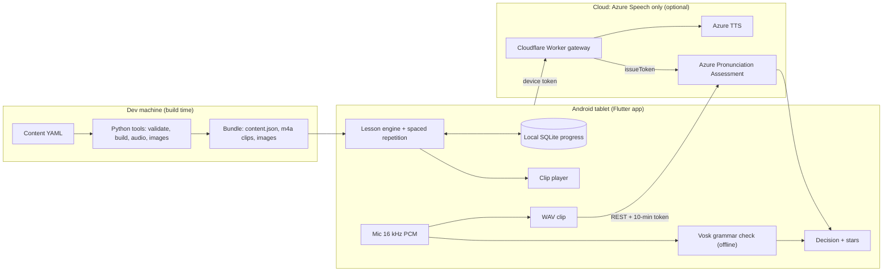

Tracking issue for a personal (non-commercial) Spanish app for our kids, aged 6–10. It turns the research notes into a build plan. Each part has its own sub-issue below.

- Plan document: [`docs/implementation-plan.md`](../implementation-plan.md)
- Research notes and verification reports: [`docs/research/`](../research/)

## Goal
A good-quality Spanish app for 6–10 year olds on an **Android tablet first** (iPad later), with:
- voice output and voice input
- no subscription
- running costs close to zero

## What changed from the research notes
The research was re-checked on 2026-11-08; the four verification reports are in `docs/research/`. These changes shape the plan:

1. **Platform: Android first, built with Flutter.** An iPad port later only needs a speech bridge and a build setup (#2).
2. **Hearing the child takes two checks.**
   - Vosk runs on the tablet in *grammar mode* and checks **which** word was said. It is small (39 MB), works offline and doesn't depend on the tablet maker.
   - Azure Pronunciation Assessment scores **how well** it was said.
   - Azure alone often gives ~100 to a wrong single word, so it can't be the only check (#16, #17).
3. **Azure scoring for Spanish** gives accuracy, fluency, completeness and word scores. Prosody, phoneme names and syllables are en-US only, so there is no phoneme-level feedback.
4. **Kokoro is not the voice.** Its Spanish voices are ungraded, weak on short words, and need GPL espeak-ng. All lesson audio is pre-generated (#7). Speech that can't be pre-generated is covered by #20:
   - online: Azure TTS in the same voice
   - offline: Android's system TTS
   - optional upgrade: Piper via sherpa-onnx
5. **Provider terms for minors apply even to a family app** (#24).
   - Gemini API, Firebase AI Logic and Google Cloud generative AI bar apps likely used by under-18s, so Gemini Live and Gemini TTS are out.
   - ElevenLabs bars apps aimed at minors unless it approves them in writing.
   - OpenAI needs parental consent, plus zero data retention for under-13 data.
   - Microsoft Azure Speech (no age clause found) is the clean option, and the only cloud provider in the plan.
6. **No Claude API and no LLMs (owner decision).** Conversation practice is **scripted, branching dialogues** (#21). Character lines are pre-generated audio, and the child's answers are checked on the tablet by Vosk. It works fully offline, is safe by construction, and costs nothing to run. It is optional.
7. **Installing on Android:** `adb install` stays exempt from Google's developer verification. No fees (#22).

## Architecture

## Roadmap
| Phase | Issues | Outcome |
|---|---|---|
| 0 Foundations | #2 Stack decision · #3 Scaffolding & CI · #4 Speech & voice spike | Decisions made; the risky parts proven on the real tablet |
| 1 Content | #5 Curriculum · #6 Content schema & tools · #7 Audio pipeline · #8 Illustrations | Units 1–3 written, voiced and bundled; the rest follow |
| 2 Core app (offline) | #9 Architecture & data · #10 Audio playback · #11 Lesson engine & activities · #12 Spaced repetition · #13 Kid UX & rewards · #14 Parent area | Playable listening lessons |
| 3 Speaking | #15 Mic capture · #16 On-device word check · #17 Azure scoring & stars · #18 Gateway · #19 Calibration | Kids say words and earn stars |
| 4 Dynamic voice | #20 | Names, custom word lists, offline fallback voice |
| 5 Conversation (optional) | #21 | Scripted, branching role-play dialogues, offline |
| 6 Ship & extend | #22 Android release & install · #23 iPad port | On the kids' tablet; iPad later |
| Cross-cutting | #24 Privacy, terms & child safety · #25 Testing & playtests | |

**MVP ("v1 family release")** = Phases 0–3 plus #22. Phases 4–5 and #23 come after.

**Suggested order:**
1. #2, then #3.
2. #4, with #5 writing running alongside.
3. #6, then #7 and #8.
4. #9, then #10 and #12, then #11, then #13 and #14.
5. #15, #16, #18, #17, #19.
6. #22 (MVP), then #20, #21 and #23.

#24 and #25 run throughout.

## Decisions the owner still needs to make
- [x] Platform: Android first (decided 2026-11-08) — #2
- [ ] Spanish variety (default: Latin American / Mexican) — #5
- [ ] Which tablet(s) the kids will use — #4
- [ ] Lesson voice and provider, after an audition and a terms review — #4, #7, #24
- [x] No Claude API / no LLMs (decided 2026-11-08) — #21, #24
- [ ] Whether to build scripted conversation practice (Phase 5) — #21
- [ ] Keep this repo private? (It may hold kids' names and progress exports) — #24

## Running costs (estimates — check current prices)
| Item | Cost |
|---|---|
| Azure Speech F0 (free tier): 5 audio hours/month of speech-to-text and pronunciation scoring, 0.5M TTS characters | $0. Scoring is about 1.7 h per child per month, so 2 kids fit. A 3rd child may need the paid S0 tier (about $1 per audio hour, verify) |
| Cloudflare Worker gateway | $0 (free plan) |
| Lesson audio generation (one-off) | $0 on Azure F0; about $6–22 for one month of ElevenLabs if chosen |
| Conversation practice (scripted, on-device) | $0 |
| Android installs | $0 |
| iPad later | $99/year Apple Developer Program |

## Conventions for the sub-issues
- Each issue has: Context, Spec, Tasks, Acceptance criteria and Open questions.
- Sizes are for one developer working with AI help: **S** ≤ 1 day, **M** 2–4 days, **L** 1–2 weeks.
- Facts marked *(verify)* came from secondary sources. Re-check them before relying on them.
- No child audio, names or recordings in the repo or CI (#24).
